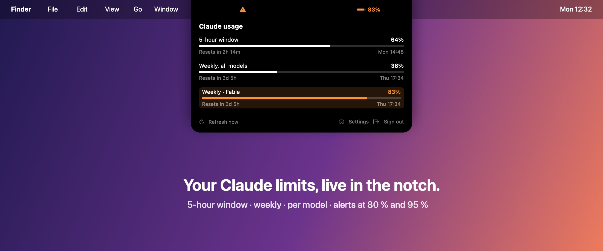
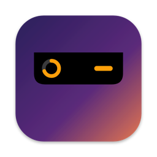
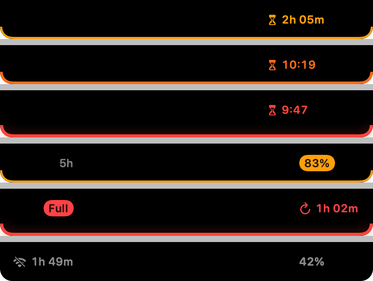
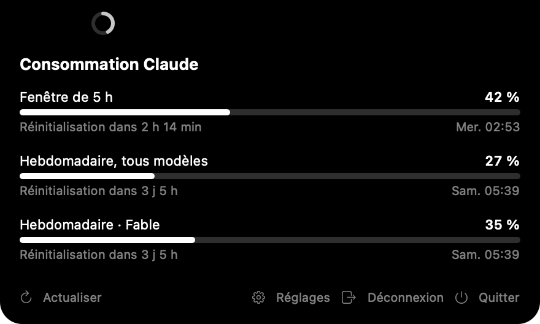

<p align="center">
  
</p>

<p align="center">
  
</p>

<h1 align="center">Notch Usage</h1>

<p align="center">
  <strong>Your Claude Pro, Max or Team limits, live in the MacBook notch.</strong><br>
  A gauge on the left of the notch, the time before a block on the right. Hover for the details.
</p>

<p align="center">
  <a href="https://github.com/florentmaille/Notch-Usage/actions/workflows/ci.yml"></a>
  
  
  <a href="LICENSE"></a>
</p>

---

Ever been cut off by Claude in the middle of a task? Notch Usage keeps your subscription limits one
glance away: the **5-hour window**, the **weekly limit** and the **per-model weekly limits**, each
with its reset time and a forecast of when you will hit the wall.

It is native Swift, local-first, free of telemetry, and uses about 25 MB of memory.

## How it reads

<p align="center">
  
</p>

Like the Dynamic Island: on the left of the notch, a small gauge shows the usage of the limit most likely
to block you; on the right, one number says how long before the block.

| State | Left | Right |
|---|---|---|
| All clear | grey gauge | nothing |
| A block is coming | amber gauge (2 h out), orange (under an hour), red (under 30 minutes) | time left: `2:05`, then `40′` |
| Block under 30 minutes | red gauge that beats once a minute, every 30 seconds under 10 minutes | minutes left |
| Limit reached | full red gauge | `↻1:02`, time until it comes back |
| Weekly or model limit over its threshold | amber or red gauge | the limit's short name (`7d`, `Fable`) |
| Offline or stale reading | grey wifi glyph | last known usage |
| A Claude Code session waits for you (optional) | gauge, unchanged | violet hand (approval), violet `?` (question) or white check (finished); the word for 4 seconds, then the glyph; a count when several sessions wait |
| Hover | the island stays, the full panel opens below and closes when the pointer leaves | |

The gauge fill and the number carry the information without colour.

## Features

- **Forecast, not just a percentage.** From your pace over the last hour, weighted toward the last 20 minutes, Notch Usage projects when the 5-hour window reaches 100 %; ten minutes without any increase count as a pause. The panel shows "At this pace (last hour): blocked at 16:40"; the gauge and the time on the right follow the same forecast, and the gauge beats under 30 minutes so the eye catches it without looking. Nothing moves otherwise, and nothing moves with Reduce Motion on. Weekly limits (all models, and per model such as Fable) get their own line from the average pace since the week started, nights included: "At this pace (this week): blocked Thu 14:10"; it stays in the panel and the menu, the notch keeps following the 5-hour window.
- **Thresholds as a fallback.** For weekly limits in the notch, and when no forecast is possible yet (first readings), crossing 80 % or 95 % colours the gauge amber or red. Thresholds are adjustable under *Advanced*.
- **One notification when it matters.** A macOS notification when a block is under 30 minutes, when a limit crosses the critical threshold without a forecast, and when a limit is reached: one per limit and per reset period, off in a click.
- **Claude Code waits, the notch tells you.** Turn on *Follow Claude Code* and the island shows when a Claude Code session, in the terminal or in the Claude app, asks for an approval, asks a question or finishes a turn: a violet hand, a violet question bubble or a white check on the right of the notch, until you answer. Several sessions: one glyph and a count. Hover: a *Claude Code* section lists each waiting session (title or project folder, what it waits for, since when); click one to bring its app to the front. When a block is under 30 minutes or a limit is reached, the limit keeps the right side and the session becomes a violet dot on the gauge. Optional macOS notification. Off by default.
- **Every limit, one hover away.** 5-hour window, weekly, per model, with "resets in 2h 14m" and the exact time.
- **Works everywhere.** A pill at the top of displays without a notch, out of the way in full-screen apps, where it stays fully hidden until you point at the top of the screen.
- **Menu bar icon, if you want one.** A small gauge in the menu bar, filled to the usage of the limit most likely to block you; click it for every limit, the forecast, *Refresh now*, *Settings* and *Quit*. Off by default.
- **Two ways to connect.** Reuse your Claude Code session, or sign in to claude.ai in a small window.
- **Frugal.** Refreshes every 3 minutes, backs off on errors, pauses during sleep, screen lock and Low Power Mode. Under 1 % CPU.
- **Private.** Talks only to `api.anthropic.com` and `claude.ai`. No analytics, no crash reporting, secrets in the macOS Keychain only.
- **Accessible.** VoiceOver announces every limit in one sentence, whatever the notch shows; the gauge fill and the number carry the information without colour, and Reduce Motion stops the beat.
- **English and French.** Follows your Mac's language, or pick one in Settings.

## Install

With [Homebrew](https://brew.sh):

```bash
brew install --cask florentmaille/tap/notch-usage
```

Or **download the [latest preview](https://github.com/florentmaille/Notch-Usage/releases)**, unzip it and move
**NotchUsage.app** to Applications. The preview is not notarized yet: the first time, open it, then click
**Open Anyway** in System Settings → Privacy & Security. Step-by-step instructions are in the release notes.

Requirements: macOS 14 (Sonoma) or later, Apple Silicon or Intel, and a Claude **Pro**, **Max** or **Team**
subscription.

To build from source (Xcode 16 or later):

```bash
brew install xcodegen
git clone https://github.com/florentmaille/Notch-Usage.git && cd Notch-Usage
xcodegen generate
xcodebuild -project NotchUsage.xcodeproj -scheme NotchUsage -configuration Release build
```

## Connecting your account

Hover the notch and pick one:

1. **Use your Claude Code session.** If Claude Code is installed and signed in, Notch Usage reads its access
   token from the macOS Keychain (macOS asks you once). The token stays in memory, is only used to read usage,
   and is never refreshed, so Claude Code keeps working. When it expires, click **Renew session** in the panel
   (it asks `claude` for a one-word reply) or run any `claude` command: Notch Usage picks up the renewed token
   within a minute.
2. **Sign in with your browser.** A small window opens `claude.ai`. Once you are signed in, the session cookie
   is stored in the app's own Keychain entry and the window closes. Your active organization is used. If the
   window is blocked, paste a `claude.ai` session key instead, under *Other method…*.

Sign out from the panel at any time: credentials and cached data are deleted.

## Settings



- **Open at login**.
- **Show in menu bar**: the gauge icon and its menu.
- **Notify me before a block**: a macOS notification under 30 minutes, at the critical threshold and when a limit is reached.
- **Follow Claude Code**: adds seven hook entries to `~/.claude/settings.json` (all pointing at a small shell script in the app's container), and removes exactly those when turned off; your own hooks are left untouched. Takes effect at once, even in sessions already open. *Notify me when Claude waits* adds a macOS notification for approvals and questions.
- **Language**: system, English or French.
- **Advanced**: refresh interval (1 to 15 minutes, 3 by default) and the fallback thresholds (80 % / 95 %) used when no forecast exists.

If the browser sign-in is blocked, paste a `claude.ai` session key on the sign-in screen, under *Other method…*.

<br clear="right">

## Privacy

- The only hosts the app talks to are `api.anthropic.com` and `claude.ai`.
- No telemetry, no analytics, no crash reporting.
- Secrets live in the macOS Keychain only. They never appear in logs. The browser sign-in window keeps its cookies in memory and discards everything once the session key is captured.
- The last reading and the last two hours of readings (for the forecast) are cached locally, and wiped on sign-out.
- With *Follow Claude Code* on, Claude Code runs the app's hook script at each event; the script appends the event to `~/Library/Application Support/NotchUsage/claude-events.jsonl` (mode 600). The app keeps only the event type, session id, working folder, session title and tool name, never the prompts or answers, and empties the file as soon as it has read it. Nothing leaves the machine.

## Rate limits and refresh cadence

The usage endpoint is shared with Claude Code's own polling, and Anthropic rate-limits it aggressively.
Notch Usage refreshes every **3 minutes** by default, never sends two requests less than 60 seconds apart,
backs off exponentially on errors, and pauses while the Mac sleeps, the screen is locked, or Low Power Mode is on.

## ⚠️ Risk note, please read

Anthropic does not document a public API for subscription usage. Notch Usage relies on the same
undocumented endpoints that Claude Code and the `claude.ai` usage page use, and it identifies
itself the way Claude Code does when using your Claude Code session. Anthropic's Consumer Terms
restrict automated access outside the official API, and Anthropic may change or block these
endpoints at any time.

Known enforcement so far has targeted third-party tools that run **inference** through consumer
subscriptions. Notch Usage only **reads** usage figures, locally, and sends nothing anywhere else.
That is a grey area, not an explicit permission. You use this app at your own risk.

Notch Usage is an independent project, not affiliated with or endorsed by Anthropic.

## Troubleshooting

| Symptom | What to do |
|---|---|
| macOS asks for your Keychain password | That is the Claude Code credential entry. Click **Always Allow**. Preview releases and builds from source are not signed with a stable identity, so the prompt returns after each update or rebuild. |
| "Reconnect required" with the Claude Code session | Click **Renew session** in the panel (it asks `claude` for a one-word reply), or run any `claude` command: Notch Usage picks up the renewed token within a minute. |
| Browser sign-in shows a "Just a moment" check | Complete it in the sign-in window, or paste your session key on the sign-in screen, under *Other method…*. |
| Nothing shows on an external display | The pill appears at the top of the display that holds the menu bar. Check Displays → Arrange. |

## Development

The logic lives in `NotchUsageCore`, a Swift package with no dependency beyond Foundation and 230+ tests:

```bash
swift test
```

The app (`App/NotchUsage`) is generated with [xcodegen](https://github.com/yonaskolb/XcodeGen) from `project.yml`;
its presentation tests run with `xcodebuild -scheme NotchUsage test`.
Debug builds are signed ad hoc, so macOS asks for Keychain access again after each build. With an Apple Development
certificate (free with an Apple ID, Xcode → Settings → Accounts), run `scripts/setup-local-signing.sh` once to sign
Debug builds with it and keep Keychain access across builds.

`scripts/demo.swift` drives a Debug build through its demo states (`normal`, `far`, `near`, `imminent25`, `imminent`, `blocked`,
`offline`, …) and captures the notch; the README images come from it.

Each feature is specified, planned and validated with [GitHub Spec Kit](https://github.com/github/spec-kit) in
[`specs/`](specs), from the first notch (001) and the forecast (003) to the island (012), the simpler settings (013)
and the icon (014). `scripts/release.sh <version>` signs, notarizes and packages the zip used by the Homebrew cask
(Developer ID required).

## License

MIT, see [LICENSE](LICENSE).
