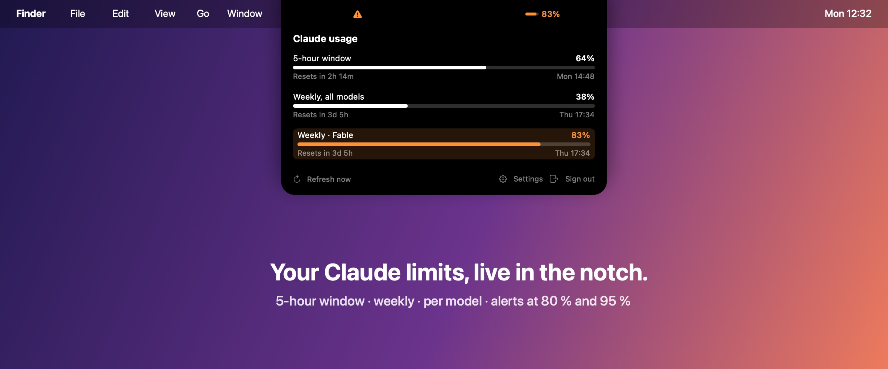

**First public preview.** Your Claude Pro, Max or Team limits, live in the MacBook notch.



## What's inside

- 5-hour window, weekly limit and per-model weekly limits, each with its reset time.
- Compact gauge next to the notch, expands on hover, click to pin.
- Alerts at 80 % and 95 % (adjustable), once per limit and per reset period.
- Pill on displays without a notch, out of the way in full-screen apps.
- Connect with your Claude Code session or by signing in to claude.ai.
- About 0.2 % CPU and 20 MB of memory. No telemetry.

## Install (preview build, not notarized)

This preview is not signed with an Apple Developer ID, so macOS blocks it the first time.

1. Download `NotchUsage-0.1.0-preview.zip` below and unzip it.
2. Move **NotchUsage.app** to your Applications folder.
3. Open it. macOS says it cannot verify the developer: click **Done**.
4. Open **System Settings → Privacy & Security**, scroll down and click **Open Anyway** next to Notch Usage, then confirm.

Prefer the Terminal? This removes the download quarantine flag instead:

```bash
xattr -dr com.apple.quarantine /Applications/NotchUsage.app
```

Then hover the notch and choose how to connect. With the Claude Code session, macOS asks once for Keychain access: click **Always Allow**.

**Checksum (SHA-256)** of the zip: `11758f25fe3b0120b91a19290b5611b691ecab8bb74239525de82d87051f8b22`

## Known limitations

- Not notarized: the Keychain may ask again after you replace the app with a newer build. Signed releases will fix this.
- Uses undocumented Anthropic endpoints that may change at any time. Read the [risk note](https://github.com/florentmaille/Notch-Usage#%EF%B8%8F-risk-note-please-read).
- English only for now.

Requires macOS 14 (Sonoma) or later, Apple Silicon or Intel.
