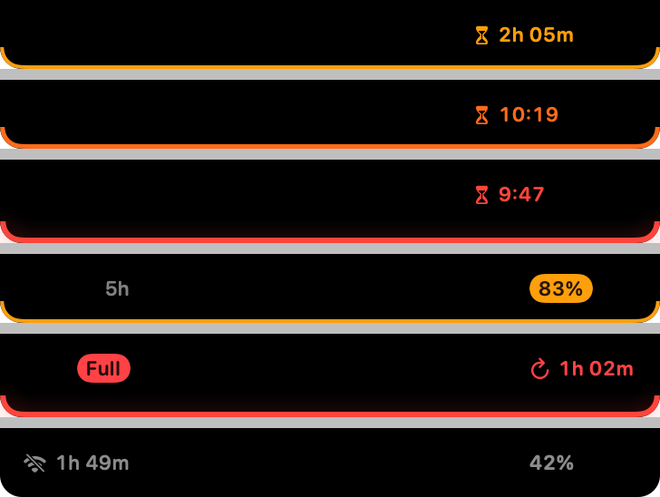

**Notch Usage now tells you when you'll hit the wall.** The compact strip is redesigned around two questions: how much is left, and when.



## What's new

- **Time to reset, always visible.** Left of the notch: a check mark and the time until your most constrained limit resets ("2h 14m", "3d 5h").
- **Blocked-at forecast.** From your pace over the last hour, Notch Usage projects when the 5-hour window reaches 100 %. If that happens before the reset, the check mark becomes an hourglass: "blocked in 1h 10m", then the clock time under an hour ("blocked at 16:40"). It needs two readings at least 10 minutes apart and only changes its mind after two consecutive readings, so it never flickers. Weekly limits keep the plain countdown.
- **Alerts you can see without colour.** Past 80 % the percentage becomes an amber pill, past 95 % a red one. When a limit is exhausted the pill reads "Full" and the left side shows the time until it comes back.
- **Offline and stale readings** turn grey with a wifi-slash glyph; the countdown keeps running from the last reading.
- **Panel and VoiceOver.** Each 5-hour window gets an "At this pace: blocked at 16:40" line, and VoiceOver announces the forecast after the percentage.
- Readings from the last two hours are kept in `history.json` inside the app's container, cleared when you sign out. No new network request: still 3 readings every 10 minutes.
- Also: **Quit** in the panel, Homebrew install, French interface with a language setting (from 0.2.x).

## Install (preview build, not notarized)

With Homebrew:

```bash
brew install --cask florentmaille/tap/notch-usage
```

Already installed? `brew upgrade --cask notch-usage`. Otherwise:

1. Download `NotchUsage-0.3.0-preview.zip` below and unzip it.
2. Move **NotchUsage.app** to your Applications folder, replacing the previous version if you have one.
3. Open it. macOS says it cannot verify the developer: click **Done**.
4. Open **System Settings → Privacy & Security**, scroll down and click **Open Anyway** next to Notch Usage, then confirm.

Upgrading: macOS asks again for Keychain access. Click **Always Allow**.

**Checksum (SHA-256)** of the zip: `6052a0a9abee99086c0448875c72434404878e243b8455b5c179d480dd645fdd`

## Known limitations

- Not notarized: the Keychain may ask again after you replace the app with a newer build. Signed releases will fix this.
- The forecast covers the 5-hour window only; weekly limits would need a model of your daily usage.
- Uses undocumented Anthropic endpoints that may change at any time. Read the [risk note](https://github.com/florentmaille/Notch-Usage#%EF%B8%8F-risk-note-please-read).

Requires macOS 14 (Sonoma) or later, Apple Silicon or Intel.
