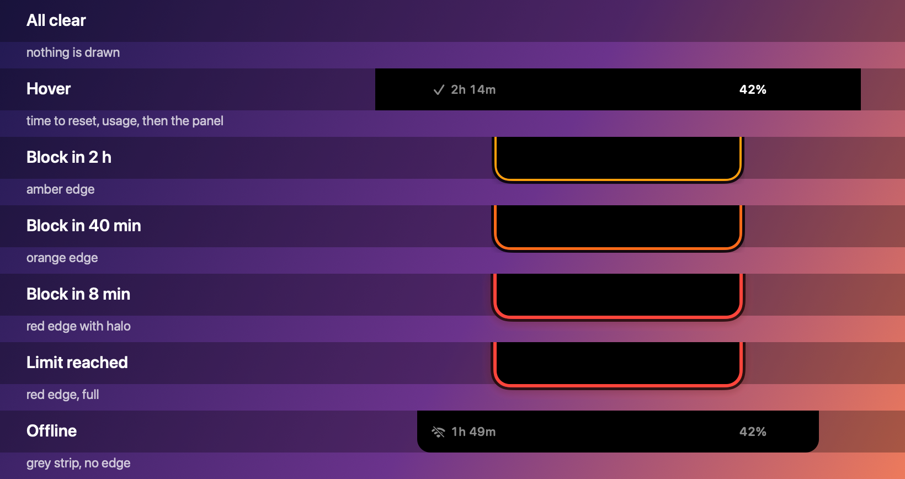

**The notch goes quiet, and lights up only when a block is coming.** The compact strip is gone from the resting state: nothing is drawn until something needs your attention.



## What's new

- **Silent notch.** When no block is predicted, no limit is above its warning threshold, the reading is fresh and the session is valid, Notch Usage draws nothing. The notch is your Mac's notch. It never widens without text to show.
- **Deadline edge.** When the forecast says the 5-hour window will run out before its reset, a coloured edge appears around the notch: amber two hours out, orange under an hour, red with a halo under 30 minutes, red when the limit is reached. The edge has one meaning, "a block is coming", and its colour says how soon. A dark outline keeps it readable on light or warm wallpapers.
- **Hover for everything.** Hovering shows the familiar strip (time to reset or to block, usage), then the panel. Click to pin, as before.
- **Thresholds as a fallback.** Weekly limits, or the 5-hour window before a forecast exists, light the same edge at 80 % (amber) and 95 % (red). On the 5-hour window the forecast wins: a pace that holds until the reset keeps the notch silent even at 90 %.
- **Choose the limit shown (0.3.x follow-up).** Settings → Notch → Limit shown: Automatic picks the limit predicted to run out first, otherwise the 5-hour window; or pin the weekly limit or one model. The edge, the strip and the full-screen dot follow that choice.
- **Pill and full screen.** On a display without a notch the pill disappears when all is well and comes back with the edge or on hover. In full-screen apps the hidden strip takes the edge colour.
- **VoiceOver** keeps announcing the full strip, in the silent state too. Reduced-motion users get no fade.
- Same budget: under 1 % CPU, about 25 MB, no new network request.

## Install (preview build, not notarized)

With Homebrew:

```bash
brew install --cask florentmaille/tap/notch-usage
```

Already installed? `brew upgrade --cask notch-usage`. Otherwise:

1. Download `NotchUsage-0.4.0-preview.zip` below and unzip it.
2. Move **NotchUsage.app** to your Applications folder, replacing the previous version if you have one.
3. Open it. macOS says it cannot verify the developer: click **Done**.
4. Open **System Settings → Privacy & Security**, scroll down and click **Open Anyway** next to Notch Usage, then confirm.

Upgrading: macOS asks again for Keychain access. Click **Always Allow**.

**Checksum (SHA-256)** of the zip: `723a3cf830fb38cd07e33173cbc6ad83013b117bd88e941e63e9595493c5b2fa`

## Known limitations

- Not notarized: the Keychain may ask again after you replace the app with a newer build. Signed releases will fix this.
- The forecast covers the 5-hour window only; weekly limits use thresholds.
- Uses undocumented Anthropic endpoints that may change at any time. Read the [risk note](https://github.com/florentmaille/Notch-Usage#%EF%B8%8F-risk-note-please-read).

Requires macOS 14 (Sonoma) or later, Apple Silicon or Intel.
