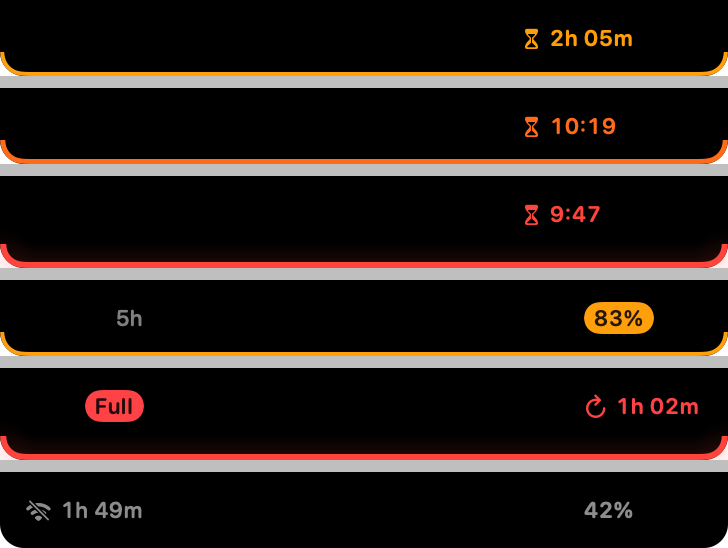

**The notch becomes an island.** Like the Dynamic Island on iPhone: a gauge on the left of the notch, the time before a block on the right.



## What's new

- **Island on each side of the notch.** On the left, a small ring gauge shows the usage of the limit most likely to block you: grey when all is well, amber, orange then red as the forecast block gets closer, full red when the limit is reached. On the right, one number, only when there is something to say: time before the block (`2:05`, then `40′`), `↻1:02` until a reached limit comes back, or the limit's short name (`7d`, `Fable`) over a threshold. The coloured edge around the notch is gone.
- **The gauge beats** under 30 minutes, once a minute, then every 30 seconds under 10 minutes; nothing moves otherwise, nothing with Reduce Motion on.
- **Hover is smooth and keeps the island.** The island stays in place while the panel opens below it; no more jump, no more square corners at the end of the animation.
- **No more pinning.** The panel opens on hover and closes when the pointer leaves; Escape closes it too. An open menu (Language) keeps it open.
- **Simpler settings.** *Open at login*, *Notify me before a block* and *Language* on top; refresh interval and fallback thresholds under *Advanced*. The panel fits its content, no more empty black area. The session key field moved to the sign-in screen under *Other method…*.
- Same budget: under 1 % CPU, about 25 MB, no new network request.

## Install (preview build, not notarized)

With Homebrew:

```bash
brew install --cask florentmaille/tap/notch-usage
```

Already installed? `brew upgrade --cask notch-usage`. Otherwise:

1. Download `NotchUsage-0.5.0-preview.zip` below and unzip it.
2. Move **NotchUsage.app** to your Applications folder, replacing the previous version if you have one.
3. Open it. macOS says it cannot verify the developer: click **Done**.
4. Open **System Settings → Privacy & Security**, scroll down and click **Open Anyway** next to Notch Usage, then confirm.

Upgrading: macOS asks again for Keychain access. Click **Always Allow**.

**Checksum (SHA-256)** of the zip: `ad5bd4784e14a528203d22f2729d9d023c03bbf6059e447c1f9727fa918a7196`

## Known limitations

- Not notarized: the Keychain may ask again after you replace the app with a newer build. Signed releases will fix this.
- The forecast covers the 5-hour window only; weekly limits use thresholds.
- Uses undocumented Anthropic endpoints that may change at any time. Read the [risk note](https://github.com/florentmaille/Notch-Usage#%EF%B8%8F-risk-note-please-read).

Requires macOS 14 (Sonoma) or later, Apple Silicon or Intel.
