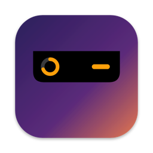

**Notch Usage gets an icon, and an optional gauge in the menu bar.**



## What's new

- **App icon.** The island, a black notch with its orange gauge, on the Notch Usage gradient. It shows in Finder, Applications and Spotlight.
- **Menu bar gauge, if you want one.** Settings → *Show in menu bar* adds a small monochrome ring to the menu bar, filled to the usage of the limit most likely to block you. Click it for every limit with its reset and forecast, *Refresh now*, *Settings* and *Quit*. Off by default; it follows the light or dark menu bar.

## Install (preview build, not notarized)

With Homebrew:

```bash
brew install --cask florentmaille/tap/notch-usage
```

Already installed? `brew upgrade --cask notch-usage`. Otherwise:

1. Download `NotchUsage-0.5.1-preview.zip` below and unzip it.
2. Move **NotchUsage.app** to your Applications folder, replacing the previous version if you have one.
3. Open it. macOS says it cannot verify the developer: click **Done**.
4. Open **System Settings → Privacy & Security**, scroll down and click **Open Anyway** next to Notch Usage, then confirm.

Upgrading: macOS asks again for Keychain access. Click **Always Allow**.

**Checksum (SHA-256)** of the zip: `69b77988eb995b56e173ea285a326b45164b53b9dad5294fa9573fd7345a1a4e`

## Known limitations

- Not notarized: the Keychain may ask again after you replace the app with a newer build. Signed releases will fix this.
- The forecast covers the 5-hour window only; weekly limits use thresholds.
- Uses undocumented Anthropic endpoints that may change at any time. Read the [risk note](https://github.com/florentmaille/Notch-Usage#%EF%B8%8F-risk-note-please-read).

Requires macOS 14 (Sonoma) or later, Apple Silicon or Intel.
